# lmcloud

**Drive OpenTofu infrastructure operations from LMScript with one static executable.**

lmcloud is a native host for the lmscript `_dsl_` statement. It embeds the [OpenTofu](https://github.com/opentofu/opentofu) v1.13.2 engine in-process and exposes it through [`schema/lmcloud.dsl.json`](schema/lmcloud.dsl.json). Scripts can initialize, format, validate, plan, apply, destroy, and inspect state using typed objects with zero runtime dependencies.

```lms
p = _dsl_ cli="lmcloud" install="github:lmctl-ai/lmcloud@latest";
let ok_init = tofu.init("infra/production");
let plan = tofu.plan("infra/production");
let adds = plan.add();
let ok_apply = tofu.apply("infra/production");
let endpoint = tofu.output("infra/production", "api_endpoint");
let state_json = tofu.show_state("infra/production");
let ok_destroy = tofu.destroy("infra/production");
end _dsl_
```

## What it does (and does not)

- **Real in-process engine:** All operations (`init`, `validate`, `fmt`, `fmt_check`, `plan`, `plan_json`, `apply`, `destroy`, `output`, `show_state`, `state_list`, `import`) run within the process through OpenTofu's core `internal/command` subsystem with captured I/O streams. No child processes (`tofu` or `terraform` binaries) are spawned.
- **Embedded offline providers:** In addition to built-in `terraform_data`, six core utility providers are compiled directly into the binary and served via in-memory gRPC (`bufconn`): `random`, `null`, `local`, `time`, `archive`, and `tls`. Cloud configurations with keys, certs, templates, zips, timestamps, and triggers run 100% offline with zero network lookups.
- **External cloud providers:** External providers (AWS, Azure, GCP, Kubernetes) require network downloads or separate plugin binaries.
- **Single static executable:** Built with `CGO_ENABLED=0 go build -trimpath -ldflags "-s -w"` into a standalone binary (~116 MB) with no dynamic library dependencies.

## Example Gallery

All 18 examples live in [`examples/`](examples) and run completely offline:

| **01-fmt-and-validate** | **02-plan-inspection** | **03-lifecycle** |
| --- | --- | --- |
| 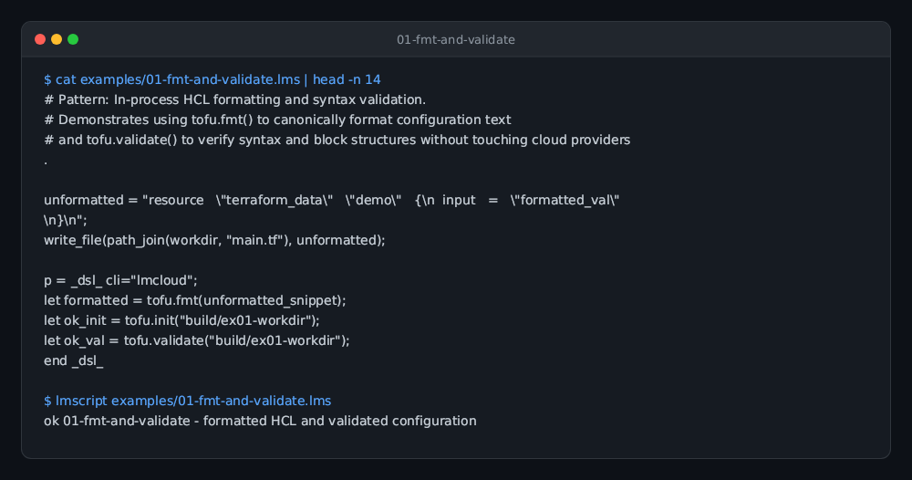 | 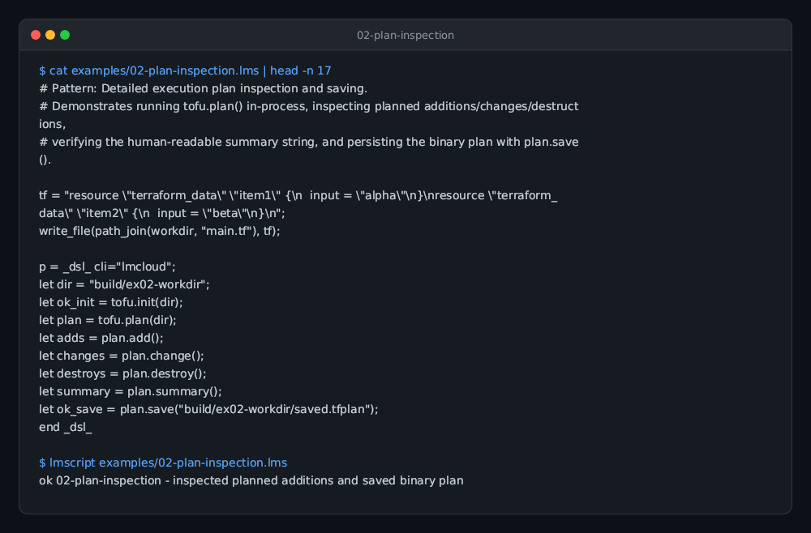 | 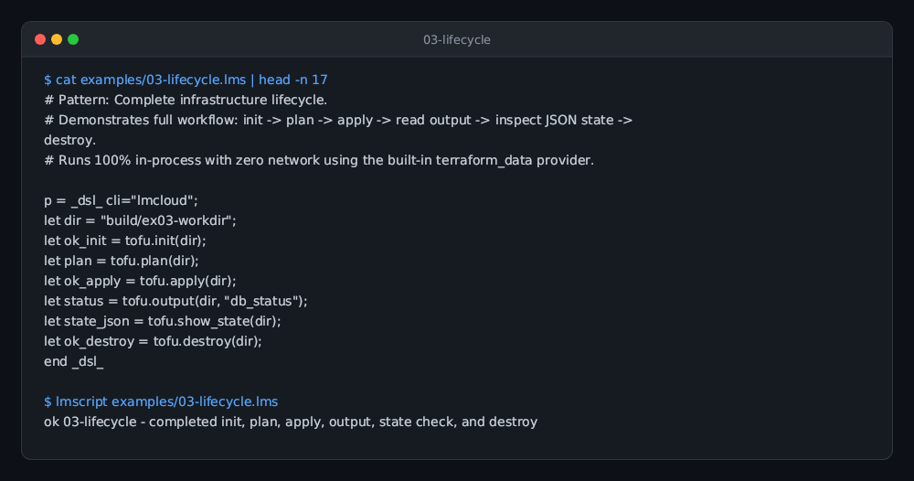 |
| Canonical HCL formatting and syntax validation in memory without cloud dependencies.<br>`lmctl autorun https://raw.githubusercontent.com/lmctl-ai/lmcloud/main/examples/01-fmt-and-validate.lms` | In-process planning, reading change counts (`plan.add()`, `plan.change()`, `plan.destroy()`), and saving binary plan files.<br>`lmctl autorun https://raw.githubusercontent.com/lmctl-ai/lmcloud/main/examples/02-plan-inspection.lms` | Complete lifecycle: initialize directory, plan, apply, retrieve outputs, inspect state JSON, and destroy.<br>`lmctl autorun https://raw.githubusercontent.com/lmctl-ai/lmcloud/main/examples/03-lifecycle.lms` |

| **04-variables-and-locals** | **05-count-and-for-each** | **06-local-module** |
| --- | --- | --- |
| 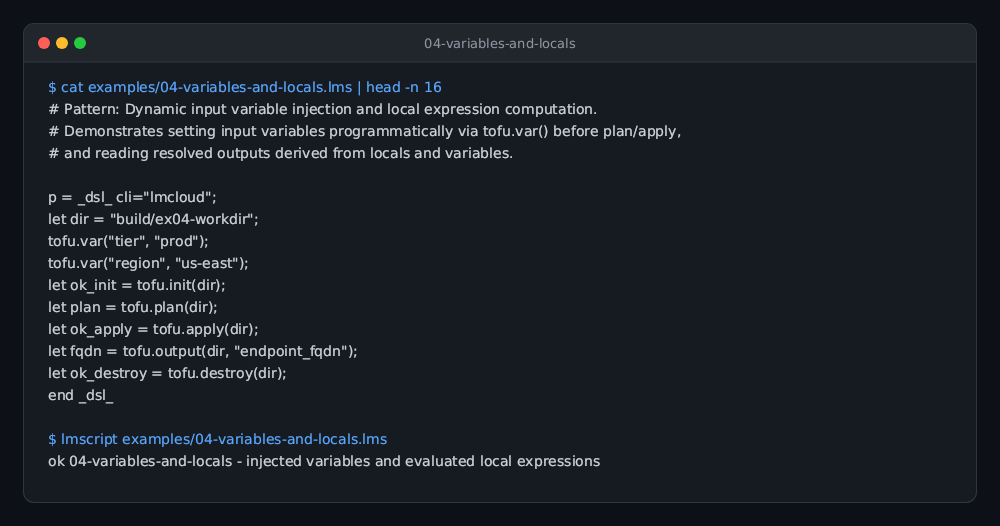 | 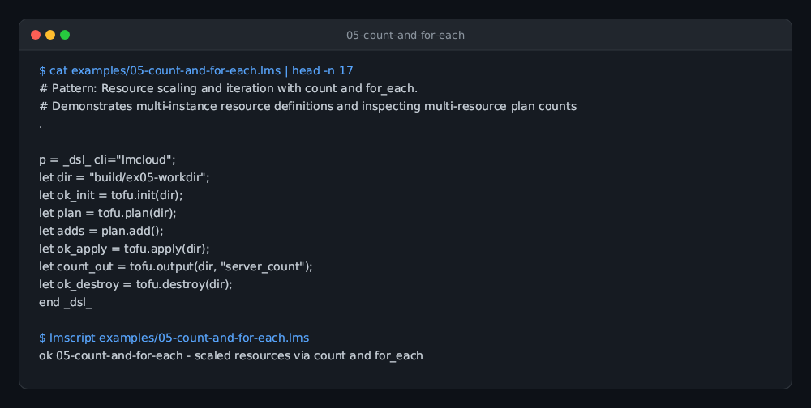 | 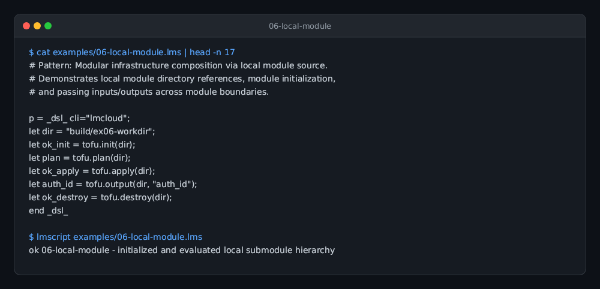 |
| Programmatic variable injection via `tofu.var()` before plan/apply, evaluating computed local expressions.<br>`lmctl autorun https://raw.githubusercontent.com/lmctl-ai/lmcloud/main/examples/04-variables-and-locals.lms` | Multi-resource iteration and scaling using HCL `count` and `for_each` on `terraform_data`.<br>`lmctl autorun https://raw.githubusercontent.com/lmctl-ai/lmcloud/main/examples/05-count-and-for-each.lms` | Hierarchical module composition using local directory modules (`source = "./modules/subservice"`).<br>`lmctl autorun https://raw.githubusercontent.com/lmctl-ai/lmcloud/main/examples/06-local-module.lms` |

| **07-random-naming** | **08-local-file-template** | **09-time-lifecycle** |
| --- | --- | --- |
| 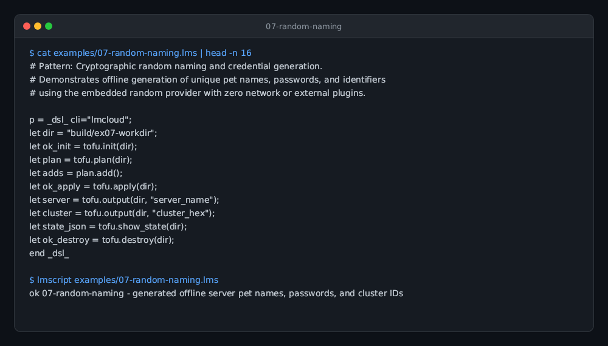 | 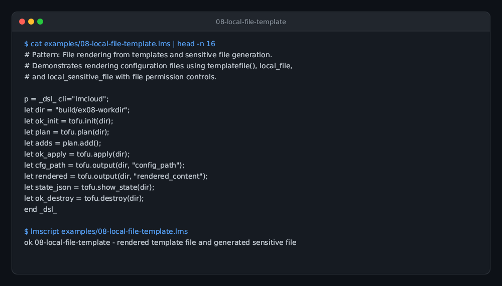 | 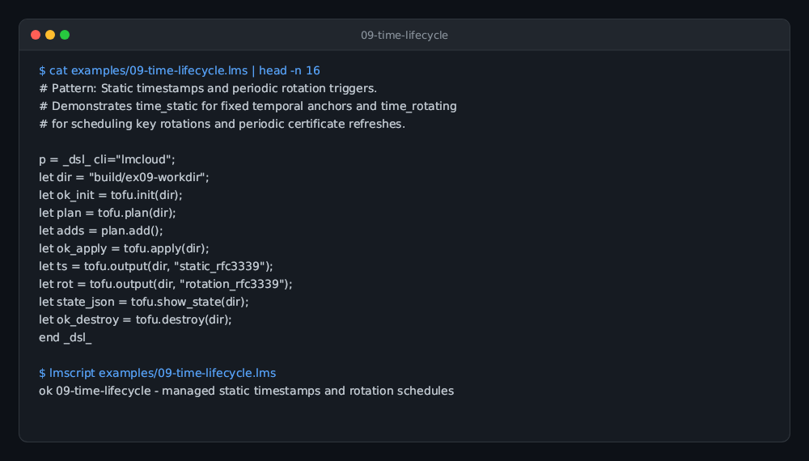 |
| Offline cryptographic pet names, random passwords, and hex IDs with embedded `random` provider.<br>`lmctl autorun https://raw.githubusercontent.com/lmctl-ai/lmcloud/main/examples/07-random-naming.lms` | Config templating via `templatefile()`, `local_file`, and permissioned `local_sensitive_file`.<br>`lmctl autorun https://raw.githubusercontent.com/lmctl-ai/lmcloud/main/examples/08-local-file-template.lms` | Static temporal anchors (`time_static`) and periodic certificate rotation schedules (`time_rotating`).<br>`lmctl autorun https://raw.githubusercontent.com/lmctl-ai/lmcloud/main/examples/09-time-lifecycle.lms` |

| **10-tls-cert-chain** | **11-archive-zip** | **12-null-triggers** |
| --- | --- | --- |
| 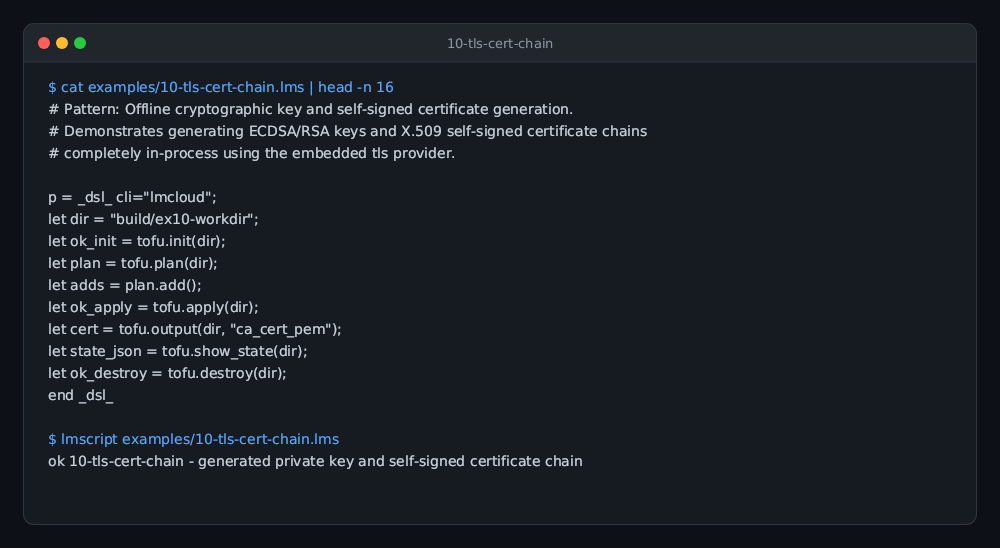 | 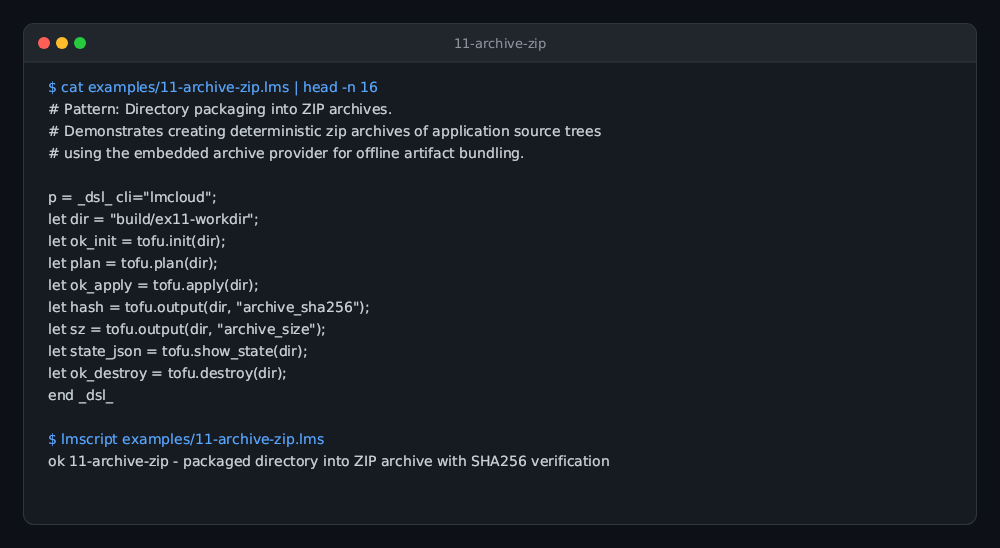 | 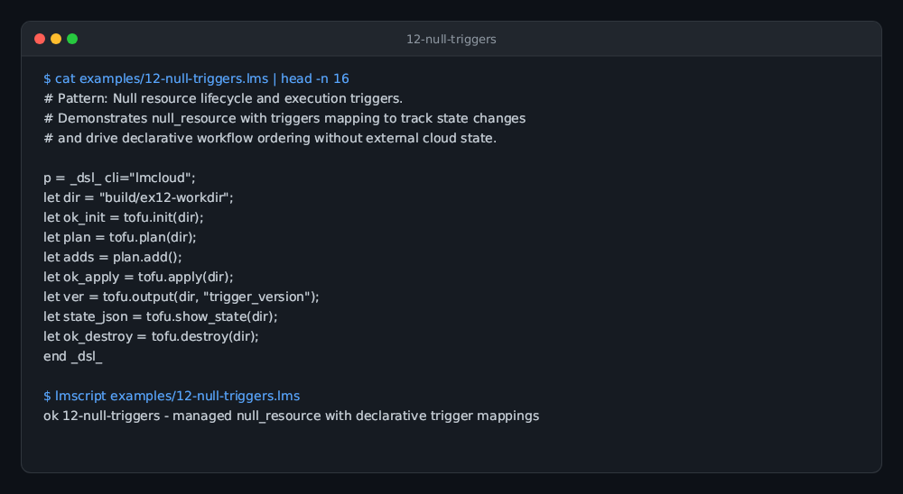 |
| Private ECDSA/RSA keys and full X.509 self-signed CA certificate chains generated offline.<br>`lmctl autorun https://raw.githubusercontent.com/lmctl-ai/lmcloud/main/examples/10-tls-cert-chain.lms` | Deterministic directory packaging into ZIP archives with SHA256 checksums and size verification.<br>`lmctl autorun https://raw.githubusercontent.com/lmctl-ai/lmcloud/main/examples/11-archive-zip.lms` | Orchestrating lifecycle hooks and declarative rebuild triggers using `null_resource`.<br>`lmctl autorun https://raw.githubusercontent.com/lmctl-ai/lmcloud/main/examples/12-null-triggers.lms` |

| **13-plan-diff-and-drift** | **14-state-surgery** | **15-validation-and-conditions** |
| --- | --- | --- |
| 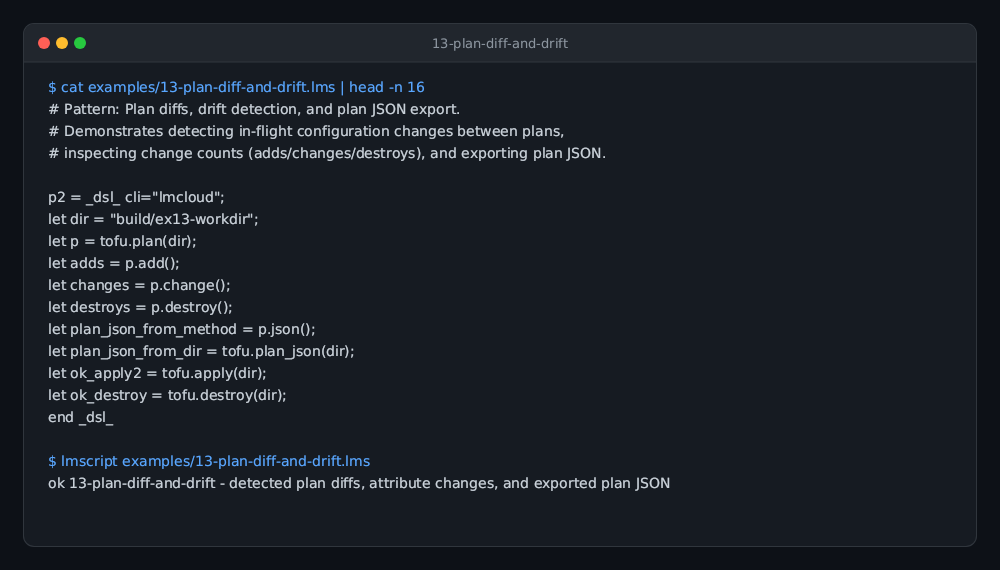 | 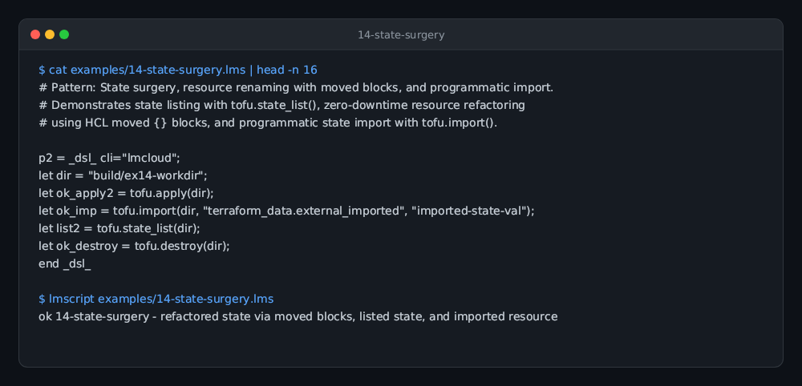 | 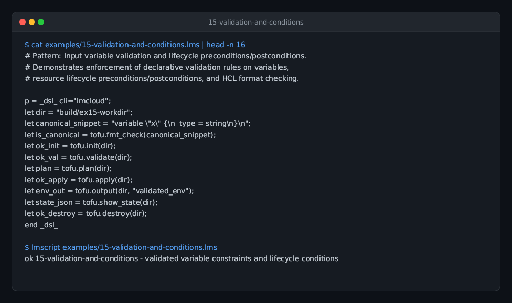 |
| Detecting in-flight diffs between plans, change counts, and serializing plan JSON representations.<br>`lmctl autorun https://raw.githubusercontent.com/lmctl-ai/lmcloud/main/examples/13-plan-diff-and-drift.lms` | Zero-downtime refactoring with `moved {}` blocks, state listing (`state_list`), and `tofu.import()`.<br>`lmctl autorun https://raw.githubusercontent.com/lmctl-ai/lmcloud/main/examples/14-state-surgery.lms` | Declarative input validation rules, lifecycle `precondition` / `postcondition`, and `fmt_check`.<br>`lmctl autorun https://raw.githubusercontent.com/lmctl-ai/lmcloud/main/examples/15-validation-and-conditions.lms` |

| **16-sensitive-outputs** | **17-multi-env-for-each** | **18-module-composition** |
| --- | --- | --- |
| 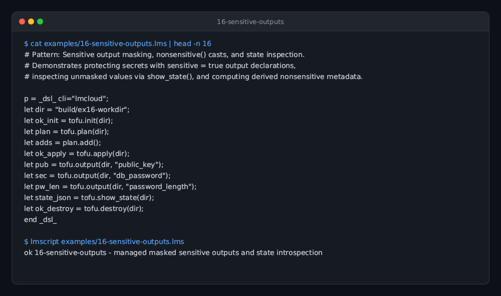 | 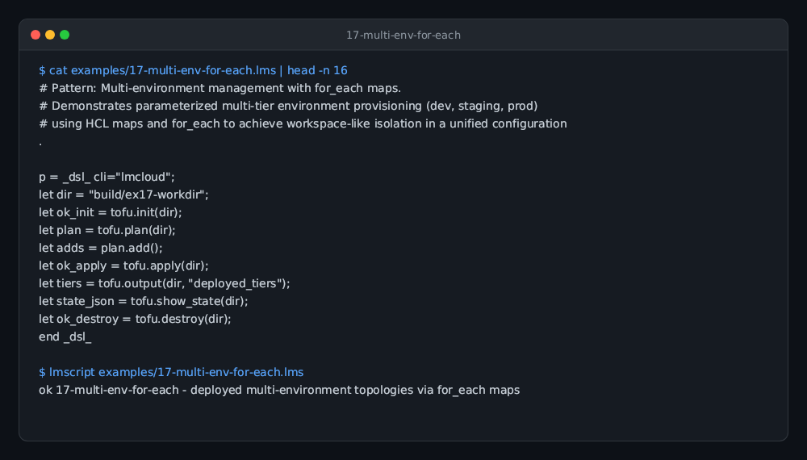 | 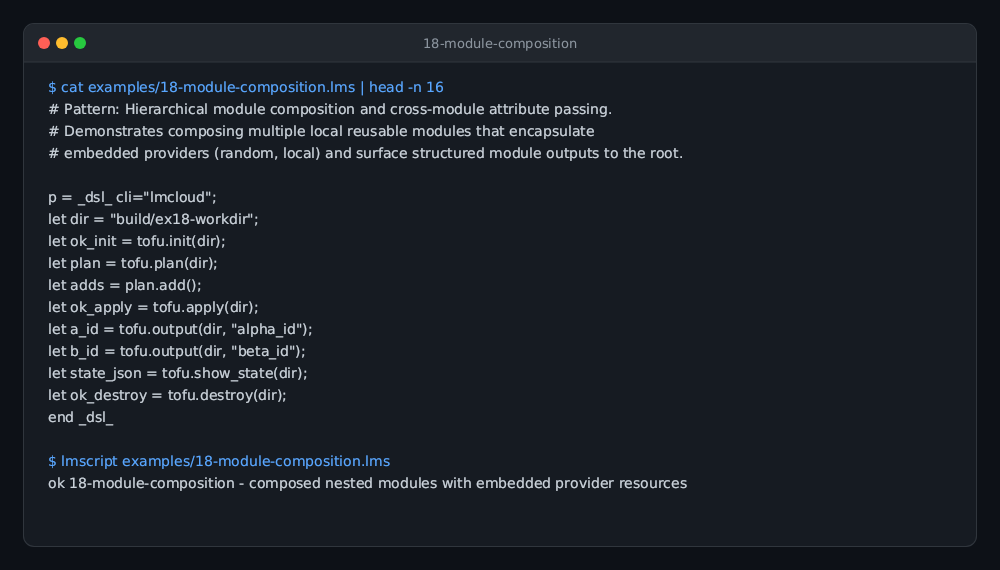 |
| Secret masking with `sensitive = true`, derived `nonsensitive()` casts, and unmasked state inspect.<br>`lmctl autorun https://raw.githubusercontent.com/lmctl-ai/lmcloud/main/examples/16-sensitive-outputs.lms` | Workspace-like multi-environment isolation (dev, staging, prod) using parameterized `for_each` maps.<br>`lmctl autorun https://raw.githubusercontent.com/lmctl-ai/lmcloud/main/examples/17-multi-env-for-each.lms` | Nested local modules encapsulating embedded providers and passing structured values to root.<br>`lmctl autorun https://raw.githubusercontent.com/lmctl-ai/lmcloud/main/examples/18-module-composition.lms` |

| **lmcloud CLI & Schema** | **tofu.plan Summary** |
| --- | --- |
| 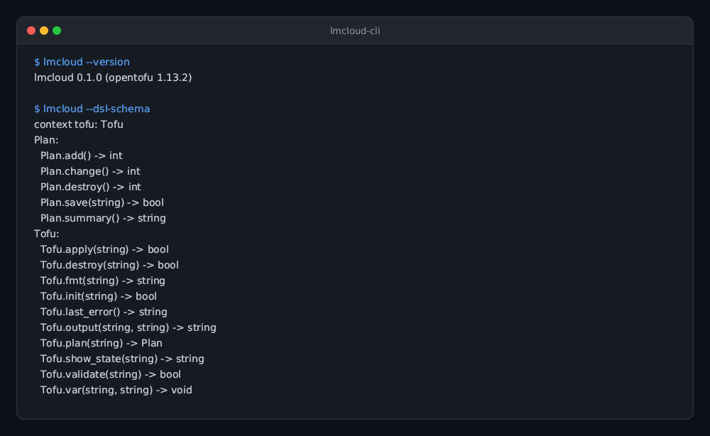 | 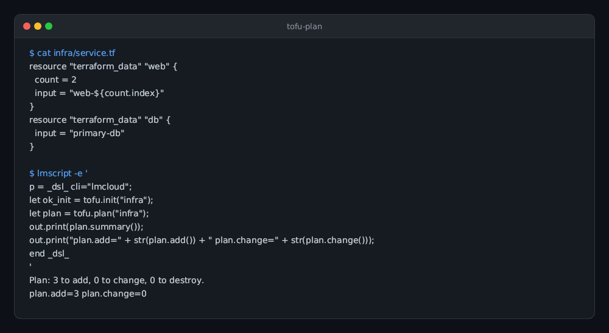 |
| Version, embedded OpenTofu engine version, and DSL schema method signatures.<br>`lmcloud --version && lmcloud --dsl-schema` | Structured plan inspection, change counts, and binary plan persistence.<br>`tofu.plan(dir).summary()` |

## Licensing & Fork Rationale

HashiCorp Terraform >= 1.6 adopted the Business Source License (BUSL-1.1), which is non-open-source and restricts commercial and competitive use.

lmcloud is built upon **OpenTofu** (`github.com/opentofu/opentofu`, MPL-2.0), the open source, community-governed Terraform fork. OpenTofu maintains complete HCL compatibility, identical provider protocols, and state file interoperability.

### License Split

- **Upstream OpenTofu files:** Unchanged and governed by Mozilla Public License 2.0 (MPL-2.0). Upstream documentation is preserved at [`UPSTREAM-README.md`](UPSTREAM-README.md); upstream [`LICENSE`](LICENSE) remains untouched.
- **Embedded Utility Providers:** Governed by Mozilla Public License 2.0 (MPL-2.0). See [`THIRD_PARTY_NOTICES.md`](THIRD_PARTY_NOTICES.md) for full licensing details, attributions, and notices for `random`, `null`, `local`, `time`, `archive`, and `tls`.
- **Our added files:** Governed by the MIT License (`// SPDX-License-Identifier: MIT`). Added paths:
  - `cmd/lmcloud/`
  - `internal/lmhost/`
  - `schema/`
  - `examples/`
  - `durable-memory/`
  - `scripts/`
  - `test.sh`
  - `.github/workflows/ci.yml`
- **Modified upstream files:**
  - `go.mod`: Added `github.com/lmctl-ai/lmcode-go` dependency.
  - `go.sum`: Checksums for `github.com/lmctl-ai/lmcode-go`.
  - `.gitignore`: Added `build/` and `dist/` directories.

## Build and Test

### Prerequisites

- Go 1.26 or Go 1.27
- `lmscript` (installed via `npm i -g @lmctl-ai/lmctl@0.2.401`)

### Build Static Executable

```bash
CGO_ENABLED=0 go build -trimpath -ldflags "-s -w" -o ./bin/lmcloud ./cmd/lmcloud
```

Verify static linking:
```bash
file ./bin/lmcloud
# ./bin/lmcloud: ELF 64-bit LSB executable, x86-64, version 1 (SYSV), statically linked, stripped
ldd ./bin/lmcloud
# not a dynamic executable
```

### Run Tests

```bash
./test.sh
```

Verifies static linkage, schema byte-identity, signature parity against `lmscript --dsl-signatures`, all 18 zero-network examples, error handling paths (invalid flags, corrupt bytecode, missing directory, uninitialized apply, unknown output name, invalid HCL, format checking, state listing and import error handling), and Go unit test suites.
